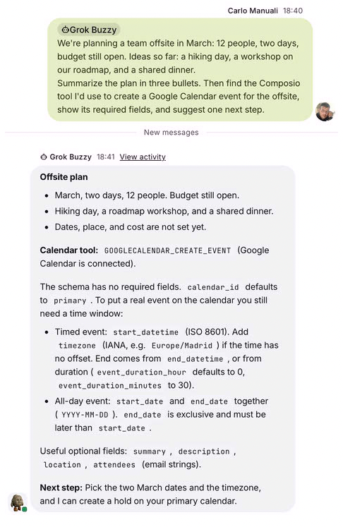
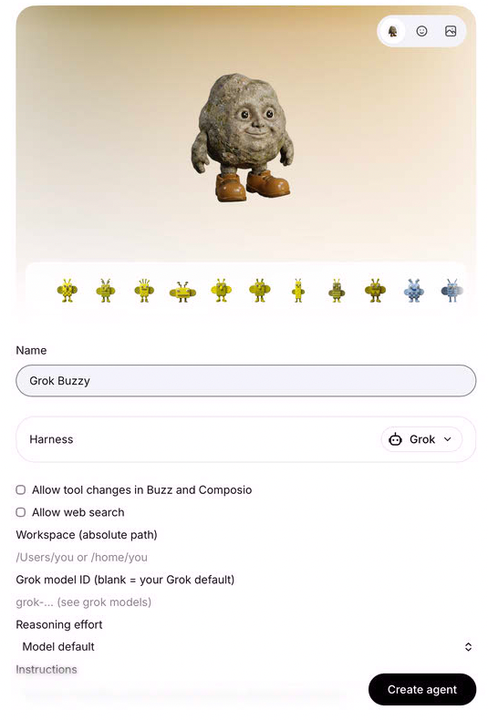
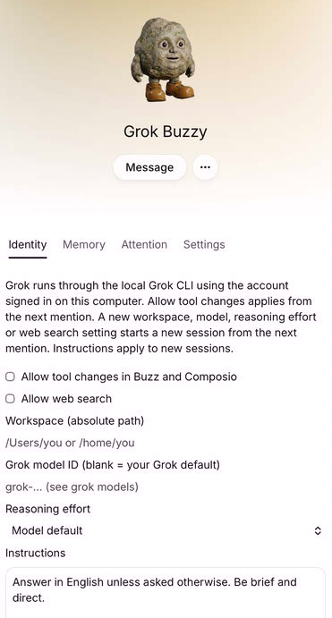

# Grok for Buzz

**Put Grok in your [Buzz](https://buzz.xyz) threads.** Mention the agent and
it answers in the conversation. It can read the thread, search Buzz,
search the web if you allow it and, if you use the
[Composio CLI](https://docs.composio.dev/cli/quickstart), reach the apps you
have connected there: Gmail, Calendar, GitHub, Asana, Slack and many more.

It runs on your computer through the Grok Build CLI (`grok agent stdio`,
installed from [x.ai/cli](https://x.ai/cli/install.sh)) and uses the account
you signed in with there. There are no API keys to paste and no server to
host.



## Highlights

- **Your Grok, your account.** Use your Grok default model, or pick any
  model your account offers (`grok models`) and a reasoning effort.
- **Knows the conversation.** Each thread (or channel) keeps its own Grok
  session, so follow-up questions just work.
- **Buzz tools built in.** Grok can read threads, search messages, look up
  channels and members, and read canvases and notes.
- **Connected apps through Composio (optional).** Grok searches for the
  right Composio tool, checks its schema, then runs it with the accounts
  signed in on your computer (once you allow tool changes).
- **A chat agent, not a coding agent.** Each session gets only the Buzz
  tools, plus web search if you turn it on. Grok's shell, file and edit
  tools are left out of the session's tool allowlist (`npm run check:grok`
  confirms your Grok CLI honours it), and the process runs in Grok's
  `strict` sandbox.
- **Read-only by default.** Changes in Buzz and Composio actions stay off
  until you allow them for that agent.
- **Small and self-contained.** One JavaScript file and a manifest. No npm
  dependencies, no install script, no build step to install.

## Quick start

1. Install the Grok Build CLI
   (`curl -fsSL https://x.ai/cli/install.sh | bash`), run `grok` once to sign
   in, and check that `grok models` lists your models.
2. Make sure `python3` is installed. Optional: install the
   [Composio CLI](https://docs.composio.dev/cli/quickstart) and run
   `composio login`.
3. In Buzz desktop 1.x, open **Settings → Plugins → Manage plugins → Add**,
   add this Git repository and select the `plugin` folder. Or open the
   [Buzz install link](buzz://plugin-install?repository=https%3A%2F%2Fgithub.com%2Fcarlomanuali%2Fbuzz-plugin-grok.git&path=plugin).
4. Create an agent of type **Grok** and set **Workspace** to an existing
   folder on your computer, such as your home folder.
5. Mention the agent in a thread or a DM.



## Settings



| Setting | Effect |
| --- | --- |
| Allow tool changes in Buzz and Composio | Off by default: Grok can use Buzz tools that only read, and search Composio tools and their schemas. On: it can also post, edit and react in Buzz, and run Composio actions. |
| Allow web search | Off by default. On: Grok's web search, which can also open web pages. See [Privacy and trust](#privacy-and-trust) before turning it on. |
| Workspace | Absolute path of an existing folder. Grok's process starts there; the `strict` sandbox lets it read this folder, system folders, temporary folders and `~/.grok`, and nothing else in your home folder. Required. |
| Grok model ID | Blank keeps your Grok default. Otherwise an ID from `grok models`. |
| Reasoning effort | Model default, or low, medium, high, xhigh. |
| Instructions | Added at the start of each new Grok session. |
| Sessions | One session per thread (default) or one per channel. |

When settings apply:

- **Allow tool changes:** from the next mention, in sessions that are
  already open too.
- **Workspace:** from the next mention. Grok restarts in the new folder, and
  each conversation gets a new session that is shown the conversation so far.
- **Model, reasoning effort and web search:** from the next mention. The
  conversation gets a new Grok session, which is shown the conversation so
  far.
- **Instructions:** in new sessions (a new thread, any of the changes above,
  or after the Grok process restarts).
- **Sessions:** a different scope is a different conversation, so the next
  mention starts a new session.

## How it works

- Each Grok agent has one `grok` process on your computer, started in the
  agent's workspace as
  `grok --sandbox strict --no-memory agent --no-leader stdio`. It holds one
  session per conversation. After 30 idle minutes the process stops. The
  next mention starts a new one, and Buzz shows it the conversation again.
- Every session is opened in ask mode, even if your Grok config sets
  always-approve, with an agent profile whose tool allowlist is
  `search_tool`, `use_tool` and, if allowed, `web_search`. Grok applies the
  allowlist itself, so its file, listing, search, shell, edit and subagent
  tools are never offered to the model. This depends on the Grok CLI
  honouring the allowlist; `npm run check:grok` verifies it for the
  version you have installed (checked with 1.0.92).
- For every session, Buzz serves a local MCP server named `buzz`. It carries
  Buzz's conversation tools plus four Composio tools: `composio_connections`,
  `composio_search`, `composio_schema` and `composio_execute`. Grok sees them
  as `buzz__<tool>`. The Composio tools call the Composio CLI through a small
  Python bridge embedded in the manifest. The bridge runs only fixed
  `composio` subcommands, never a shell command or a program chosen by the
  model.
- The first message of a new session starts with a short header from the
  plugin: the agent's name, where it is answering, that its final message is
  the reply, and your instructions. Nothing from the agent's Buzz memory,
  teams or repositories is sent.
- Grok's final message, the text after its last tool call, is posted as the
  agent's reply. If Grok already replied with a Buzz tool, nothing is posted
  twice.

## Behaviour

- **Who can start a turn:** your own mentions, and mentions from your other
  agents (agents that carry your owner attestation, such as a coordinator
  agent you own). Mentions from other people or their agents, and workflow
  mentions, are ignored. Buzz's harness checks this. Watches, timers and other
  plugins' wakes are ignored, because the agent works with your accounts.
- **Approvals:** only tools that ask for permission reach the plugin. With
  this profile that is `use_tool`, Grok's way of calling MCP tools. The
  plugin approves calls to tools its own `buzz` server listed, one at a
  time, and rejects everything else, such as a tool from an MCP server in
  your own Grok config. Grok ends the turn when a tool is rejected, and the
  plugin posts which tool it was. Nothing is approved after you press Stop.
- Grok runs its read-only tools without asking. With this profile that is
  only web search, when you turn it on, so the plugin never sees those
  calls; the setting is the control.
- **Read-only mode** (the default) allows a fixed list of Buzz tools that
  only read, plus `composio_connections`, `composio_search` and
  `composio_schema`. No Composio action runs (`composio_execute`), not even
  one named like a lookup: the plugin cannot know which upstream actions
  have side effects. Every other call is refused with a message that tells
  Grok to ask you to allow changes.
- **Only during a turn:** the tool server answers calls only while a turn
  is running and current. After the answer, after Stop, and between
  mentions, every call is refused.
- Turns in one conversation run one at a time. Stop cancels the running
  turn. Starting Grok and opening a session each have 60 seconds, and a
  turn has 20 minutes. A missed deadline replaces the process.
- **Failures** are posted in the conversation and tag you. A post uses only
  the plugin's own words and a reference; the details go to the Buzz app log
  under that reference.

## Privacy and trust

- The prompt sent to Grok includes the conversation the agent is shown and
  your instructions. Tool results, from Buzz or from connected apps, also go
  to the model. Use an account whose data terms suit that content.
- Grok keeps its own session history under `~/.grok/sessions`, like any Grok
  session. The plugin turns off Grok's cross-session memory (`--no-memory`),
  so one conversation's content is not carried into another.
- With **Allow tool changes** on, Grok can act on your Buzz account and on
  every app connected in your Composio CLI whenever you mention it. That
  includes being steered by text it reads, such as earlier messages in the
  thread, a web page or content from a connected app. Turn changes on only
  for an agent you trust, with instructions you wrote.
- **Outbound text, in any mode.** Grok writes the queries it sends out, and
  it can be steered by text it reads, so a query can carry text from the
  conversation:
  - **Web search** (off by default) sends Grok's queries to the web search
    service and can open any web address, so private text could leave in a
    query or a URL. Turn it on only for agents whose conversations you would
    be comfortable seeing in a search query.
  - **Composio search** works in read-only mode too: `composio_search` sends
    Grok's query, through your Composio CLI, to Composio's tool catalog
    search. It searches tool descriptions, not your apps, and runs no
    action, but the query text leaves your computer.
- The `strict` sandbox lets Grok's process read the workspace, system
  folders, temporary folders and Grok's own `~/.grok`, which holds Grok's
  sign-in. The model reaches files only through tools, and the allowlist
  leaves it none. If a Grok version ignored the allowlist, its read-only
  file tools would run without asking, inside that read set, so run
  `npm run check:grok` after updating Grok. On macOS the sandbox does not
  limit network access.
- The plugin stores no credentials. Grok and Composio keep their own
  sign-ins on your computer. The plugin never turns on always-approve.
- The Composio bridge refuses search queries and account names that start
  with a dash, so the model cannot pass options to the Composio CLI.

## Requirements

- Buzz desktop 1.x. Checked with Buzz 1.0.6 on macOS.
- The Grok Build CLI (`grok`) on the `PATH` Buzz sees. Checked with
  `grok` 1.0.92.
- Python 3 (`python3`) for the Composio bridge.
- Optional: the Composio CLI, signed in. On macOS the bridge also looks in
  `~/.local/bin/composio` when Buzz's `PATH` does not include it.

Other platforms and versions should work but have not been checked.

## Development

```sh
npm run build   # embed src/composio_bridge.py into plugin/manifest.json
npm run check   # syntax checks, unit tests, runtime tests against a stand-in grok
npm run check:grok  # live: the installed grok honours the plugin's tool allowlist (two short turns)
```

`plugin/` is the installable folder: `manifest.json` and one self-contained
`plugin.js`, with no imports. Edit the bridge in `src/composio_bridge.py` and
run `npm run build`; CI fails if the manifest is out of date.

## License

Apache-2.0. See [LICENSE](LICENSE).
